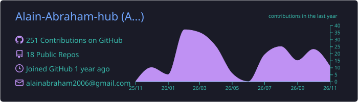
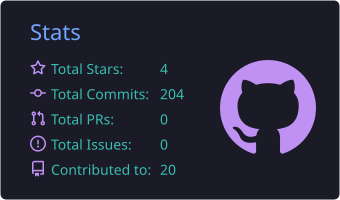
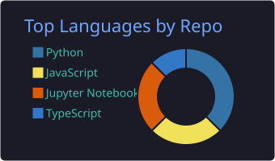
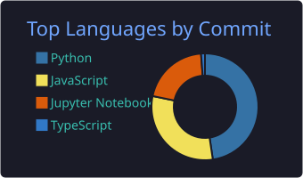
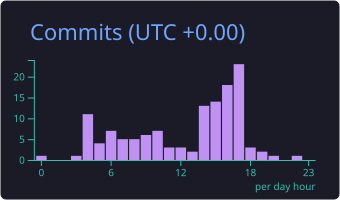

<!-- Hero Banner -->
<div align="center">
  

  <br />

  <!-- Animated Typing Subtitle -->
  

  <br />

  <!-- Quick-Connect Bar -->
  <a href="https://www.linkedin.com/in/alain-abraham-b91193304" title="Connect on LinkedIn">
    
  </a>
  &nbsp;
  <a href="https://Alain-Abraham-Hub.github.io" title="Visit my Portfolio">
    
  </a>
  &nbsp;
  <a href="mailto:alainabrahamsj@gmail.com" title="Email me">
    
  </a>
  &nbsp;
  <a href="https://leetcode.com/Alain_Abraham/" title="Check my LeetCode Profile">
    
  </a>
</div>

<br />

---

## 🧠 About Me

<table width="100%">
  <tr>
    <td width="52%" valign="top">

- 🔭 **Current Focus:** Quantum Computing concepts, Variational Quantum Algorithms (**VQE**, **QAOA**), and Quantum Many-Body Dynamics.
- 🌱 **Deepening Expertise:** Sample-based Quantum Diagonalization (**SQD**), Hamiltonian simulation, and **Quantum Machine Learning (QML)**.
- ⚛️ **Hardware & Simulation:** Designing quantum circuits in **Qiskit** and executing experiments on both simulators and real **IBM Quantum** processors (`ibm_fez`).
- 🎯 **Mission:** Bridging **AI**, **Machine Learning**, and **Quantum Computing** to tackle intractable scientific and combinatorial optimization challenges.

    </td>
    <td width="48%" valign="top">

```python
class AlainAbraham:
    def __init__(self):
        self.domains = [
            "Quantum Computing",
            "Machine Learning",
            "Quantum Chemistry & Simulation",
        ]
        self.focus = [
            "VQE & SQD",
            "QAOA on IBM Quantum",
            "TFIM Spin Dynamics",
            "Quantum ML (QML)",
        ]

    def mission(self) -> str:
        return "Bridge AI & Quantum for sustainable innovation."
```

    </td>
  </tr>
</table>

---

## 🛠️ Tech Stack & Quantum Toolkit

<div align="center">

### ⚛️ Quantum & Scientific Computing


### 🤖 Languages & AI / ML


### 🧰 Developer Tools


</div>

---

## 🚀 Featured Quantum & ML Projects

<table width="100%">
  <tr>
    <td width="50%" valign="top">

### [⚛️ Quantum VQE Molecular Ground State Finder](https://github.com/alainabraham/quantum-vqe)

Variational Quantum Eigensolver (**VQE**) implementation for molecular electronic structure and ground-state energy estimation using parameterized quantum circuits.

`Qiskit` · `Python` · `Quantum Chemistry`

    </td>
    <td width="50%" valign="top">

### [🧪 SQD Algorithm Ground State Finder](https://github.com/Alain-Abraham-hub/SQD-Algorithm-Groundstatefinder)

Sample-based Quantum Diagonalization (**SQD**) subspace projection pipeline for accurate molecular ground-state estimation from quantum bitstring samples.

`Qiskit` · `Python` · `Subspace Diagonalization`

    </td>
  </tr>
  <tr>
    <td width="50%" valign="top">

### [🧲 TFIM Quantum Dynamics Simulator](https://github.com/Alain-Abraham-hub/TFIM-Quantum-Dynamics-Simulation)

Simulates time evolution of the Transverse-Field Ising Model (**TFIM**), observing average magnetization, spin interactions, and Hamiltonian energy dynamics over time.

`Qiskit` · `Python` · `Many-Body Physics`

    </td>
    <td width="50%" valign="top">

### [⚡ QAOA MaxCut on Quantum Hardware](https://github.com/Alain-Abraham-hub/QAOA-MaxCut-QuantumHardware)

Quantum Approximate Optimization Algorithm (**QAOA**) solving graph Max-Cut problems, executed directly on IBM's quantum processor (`ibm_fez`).

`Qiskit` · `IBM Quantum (ibm_fez)` · `Combinatorial Optimization`

    </td>
  </tr>
</table>

---

## 📊 GitHub Analytics & Activity

<div align="center">

  <!-- Row 1: Profile Overview & Core Stats -->
  <p>
    
    &nbsp;
    
  </p>

  <!-- Row 2: Languages & Productivity -->
  <p>
    
    
    
  </p>

  <!-- Row 3: Streak & Contribution Graph -->
  <p>
    
  </p>
  <p>
    
  </p>

</div>

---

## 🌐 Connect With Me

<div align="center">

  <a href="https://www.linkedin.com/in/alain-abraham-b91193304" title="Connect on LinkedIn">
    
  </a>
  &nbsp;
  <a href="https://Alain-Abraham-Hub.github.io" title="Visit my Portfolio">
    
  </a>
  &nbsp;
  <a href="mailto:alainabrahamsj@gmail.com" title="Email me">
    
  </a>
  &nbsp;
  <a href="https://leetcode.com/Alain_Abraham/" title="Check my LeetCode Profile">
    
  </a>

  <br /><br />

  <sub><code>⟨0|1⟩</code> &nbsp;•&nbsp; <em>"Code. Learn. Build. Repeat."</em> &nbsp;•&nbsp; <code>|ψ⟩</code></sub>

</div>
