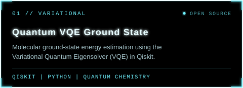
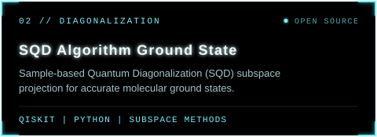
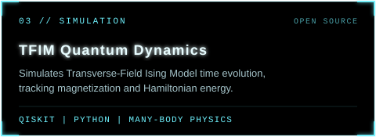
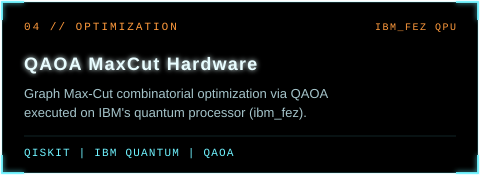

<div align="center">




<br />

<a href="https://Alain-Abraham-Hub.github.io"></a>
<a href="https://www.linkedin.com/in/alain-abraham-b91193304"></a>
<a href="https://leetcode.com/Alain_Abraham/"></a>
<a href="mailto:alainabrahamsj@gmail.com"></a>

</div>

<br />

```text
> USER ........ Alain Abraham
> DOMAIN ...... Quantum Computing, Machine Learning
> FOCUS ....... VQE, SQD, QAOA, TFIM dynamics, Quantum ML
> RUNTIME ..... Qiskit // IBM Quantum (ibm_fez)
> DIRECTIVE ... Bridge AI and quantum computation to solve real-world problems
```

<br />

<div align="center">


<br />

<sub><code>// QUANTUM</code></sub>


<sub><code>// OPTIMIZATION</code></sub>


<sub><code>// LANGUAGES</code></sub>


<sub><code>// SCIENTIFIC COMPUTING</code></sub>


<sub><code>// MACHINE LEARNING</code></sub>


<sub><code>// TOOLS</code></sub>


</div>

<br />

<div align="center">


<br />

<table width="100%">
  <tr>
    <td width="50%" align="center">
      <a href="https://github.com/alainabraham/quantum-vqe">
        
      </a>
    </td>
    <td width="50%" align="center">
      <a href="https://github.com/Alain-Abraham-hub/SQD-Algorithm-Groundstatefinder">
        
      </a>
    </td>
  </tr>
  <tr>
    <td width="50%" align="center">
      <a href="https://github.com/Alain-Abraham-hub/TFIM-Quantum-Dynamics-Simulation">
        
      </a>
    </td>
    <td width="50%" align="center">
      <a href="https://github.com/Alain-Abraham-hub/QAOA-MaxCut-QuantumHardware">
        
      </a>
    </td>
  </tr>
</table>

</div>
